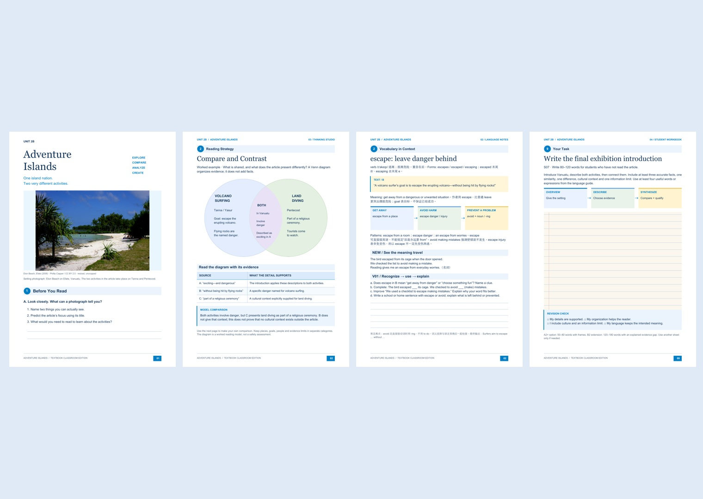

# Nonfiction Deep Reading

把英文非虚构文章转化为一套可以直接用于课堂的精读教学资料。

**先分析文本，再设计教学，最后制作蓝白原版教材风讲义。**

## 可以导出什么？

| 文件 | 内容 |
|---|---|
| Teacher Guide | 文本诊断、逐段精讲、英文问题链、教学流程与板书 |
| Vocabulary and Language | 核心词深讲、用法辨析、句子拆解与迁移练习 |
| Thinking Studio | 根据文章结构设计的思维图、已完成示范与独立练习 |
| Student Workbook | 原文、图片、阅读证据任务、口语与写作任务 |
| Answer Key and Assessment | 答案、证据、推理、示范表达与评价标准 |
| Project Studio | 真实问题、研究、设计、测试、修订与展示 |

可按需补充双语精读笔记、逐页高清PNG或配合口播的演示HTML。只要求单份资料时，不会强制生成整套。

## 蓝白教材风

白底、深蓝标题、浅蓝栏目条、蓝色编号圆点、真实主题图片、淡黄词汇提示，以及有明确用途的作答空间。六份文件共享视觉识别，各自保留不同的信息架构。



预览用于展示版式，文章内容不能直接套用到新文本。图片与教材来源见 [来源说明](assets/source-note.md)。仓库不包含整篇教材或完整教学包PDF。

## 安装到 Codex

下载本仓库ZIP并解压，将包含 `SKILL.md` 的文件夹命名为 `nonfiction-deep-reading`，放入：

```text
~/.codex/skills/nonfiction-deep-reading/
```

如果使用了自定义 `CODEX_HOME`，则放到该目录下的 `skills/`。重新打开会话，在可用技能中查看。

也可让 Codex 安装：

```text
请从 https://github.com/leilaisthecutest-create/nonfiction-deep-reading 安装这个 Skill。
```

## 怎么使用？

上传文章截图、PDF或粘贴英文原文，然后说：

```text
用 nonfiction-deep-reading 为这篇文章生成精读教学包。
学生水平B1，课堂90分钟，采用蓝白教材风。
最终让学生面向没读过原文的同学完成一份英文介绍。
```

局部输出示例：

```text
用 nonfiction-deep-reading 只生成双语精读笔记与逐页PNG。
```

## 教学与质量标准

- 根据文章体裁与结构选择策略，不把所有文本都做成同一种练习。
- 词汇、语法与最终表达相连接；提供分层支架。
- 区分原文事实、语言扩展、外部知识和推断。
- 使用有来源的真实照片或准确标注的原创示意。
- 完成后渲染并检查全部页面，同步更新PDF、图片及压缩包。

这是供AI执行的教学设计工作流，不是固定模板生成器。实际生成需要支持文件读写、PDF制作与图片检查的环境；外部资料核对需要网络。正文、字体、照片等第三方材料遵循各自的授权，不因包含在学习资料中而改变。

作者：Leila
